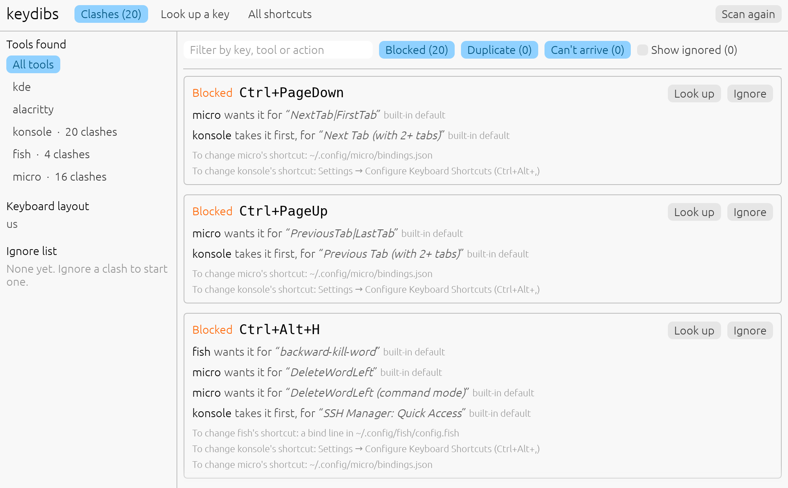

# keydibs

Find keyboard shortcuts that clash between your desktop, terminal, shell and editor.

You press a shortcut in your editor and nothing happens. Usually another tool took
the keys first: your desktop, terminal and shell all see a key press before your
editor does. keydibs reads the shortcuts of every tool you use, including the
built-in ones nobody wrote down, and shows you which ones clash.

<picture>
  <source media="(prefers-color-scheme: dark)" srcset="https://github.com/Blzs2005/keydibs/raw/HEAD/docs/app-dark.png">
  
</picture>

## Install

```sh
# 1. Install cargo-binstall, if you don't have it yet
curl -L --proto '=https' --tlsv1.2 -sSf https://raw.githubusercontent.com/cargo-bins/cargo-binstall/main/install-from-binstall-release.sh | bash

# 2. Install keydibs: downloads a ready-made keydibs, in seconds
cargo binstall keydibs

# 3. Add keydibs to your app launcher, so it opens like any other app
keydibs install-desktop
```

`keydibs gui` opens the app too. keydibs runs on Linux. If `cargo` isn't found, install
Rust from [rustup.rs](https://rustup.rs). To skip
[cargo-binstall](https://github.com/cargo-bins/cargo-binstall), `cargo install keydibs`
builds keydibs instead, which takes a few minutes. Without Rust, download keydibs from
the [latest release](https://github.com/Blzs2005/keydibs/releases/latest).

## Use

There's nothing to set up. keydibs finds the tools you have and only **reads** their
settings, never changes them.

- **Clashes** lists every clash. In the screenshot, micro wants `Ctrl+PageDown` to
  switch tabs, but Konsole takes it first to switch its own tabs. Each shortcut shows
  where it was set: *built-in default* is how the tool ships, and for shortcuts you
  set yourself it's the file and line, which opens in your editor.
- **Look up a key** shows every tool that uses a key combination, in the order a key
  press reaches them, and which one gets it. Type the keys or just press them.
- **All shortcuts** lists every shortcut keydibs found, to search and sort.

<details>
<summary><b>Shortcuts that can't arrive</b></summary>

Some key combinations can't get through a terminal at all. Most terminals send
`Ctrl+Shift+S` exactly like `Ctrl+S`, `Shift+Enter` like `Enter`, and don't pass
Super on, so a shell or editor bound to one of those never sees it. keydibs marks
these *Can't arrive*.

The *kitty keyboard protocol* fixes this, but only when the terminal supports it
**and** the program turns it on. Alacritty, Konsole, fish and Neovim do; micro,
bash, zsh and tmux don't. keydibs only reports what really can't arrive.

Inside tmux, a program only gets what tmux passes on, and tmux doesn't pass the
kitty keyboard protocol on. So keydibs marks fish's `Ctrl+Shift+Z` (redo) as one
that can't arrive in tmux. With `set -g extended-keys on`, tmux passes more keys on
if your terminal sends them, and keydibs no longer reports them.

</details>

<details>
<summary><b>Your keyboard layout</b></summary>

On a Hungarian keyboard `(` is Shift+8; on a US one it's Shift+9. Tools write such
shortcuts either way (`Ctrl+(` or `Ctrl+Shift+8`), so keydibs compares the keys you
actually press on your layout. That's why it shows `Ctrl+(` as `Ctrl+Shift+8` on a
Hungarian layout, and why it finds clashes that only exist on some layouts, like
Konsole's *Copy Input to None* taking `Ctrl+Shift+6` from fish's *undo*.

</details>

## Fix a clash

Change the shortcut you care about less in its tool, then click **Scan again**. Each
clash says where to change it.

<details>
<summary><b>Where each tool keeps its shortcuts</b></summary>

| Tool | Where to change shortcuts |
|---|---|
| KDE Plasma | System Settings → Keyboard → Shortcuts |
| GNOME | Settings → Keyboard → View and Customize Shortcuts |
| Hyprland | your Hyprland config |
| Konsole | Settings → Configure Keyboard Shortcuts (`Ctrl+Alt+,`) |
| tmux | a `bind` line in `~/.config/tmux/tmux.conf` or `~/.tmux.conf` |
| Alacritty | the `[keyboard]` section of `~/.config/alacritty/alacritty.toml` |
| fish | a `bind` line in `~/.config/fish/config.fish` |
| bash | `~/.inputrc`, or a `bind` line in `~/.bashrc` |
| zsh | a `bindkey` line in `~/.zshrc` |
| micro | `~/.config/micro/bindings.json` |
| Neovim | `vim.keymap.set` in `~/.config/nvim/init.lua` |

</details>

### Clashes you don't mind

Click **Ignore** on a clash, and choose whether to ignore it for one tool or every
clash on those keys. **Show ignored** brings them back into view, with a **Stop
ignoring** button. They're saved in `~/.config/keydibs/ignore`, the only file
keydibs writes.

<details>
<summary><b>Editing the ignore list by hand</b></summary>

One line per clash, with the keys as keydibs shows them, optionally followed by the
tools it's about:

```sh
Ctrl+Shift+Up          # every clash on these keys
Shift+Right konsole    # only the ones Konsole is part of
```

- Naming tools limits a line to clashes they're part of. `Shift+Right konsole` also
  covers Konsole blocking your shell; other terminals still get checked.
- A line covers key sequences that start with its keys: `Ctrl+X` also covers
  `Ctrl+X, Ctrl+E`.
- `#` starts a comment.
- Lines that match nothing are pointed out, which catches typos and clashes you've
  fixed since.

</details>

## In a terminal

<details>
<summary><b>Using keydibs from the command line</b></summary>

`keydibs` on its own lists every clash. On a fresh CachyOS install (KDE, Alacritty,
Konsole, fish and micro, Hungarian keyboard):

```console
$ keydibs
scanned kde (compositor): 112 bindings
scanned alacritty (terminal): 90 bindings
scanned konsole (terminal): 77 bindings
scanned fish (shell): 99 bindings
scanned micro (app): 156 bindings
keyboard layout: hu

shadowed   Shift+Right
  micro "SelectRight" (built-in default)
  is blocked by konsole "Next Tab (with 2+ tabs)" (built-in default)
…
21 conflicts in 534 bindings
```

```console
$ keydibs why ctrl+alt+h
Ctrl+Alt+H
  terminal    konsole    takes it              SSH Manager: Quick Access  (built-in default)
  shell       fish       SHADOWED by konsole   backward-kill-word  (built-in default)
  app         micro      SHADOWED by konsole   DeleteWordLeft  (built-in default)
```

| Command | What it does |
|---|---|
| `keydibs` or `keydibs check` | Lists every clash and every shortcut that can't arrive, and exits with 1 if there are any, so it works in scripts. `--no-ignore` includes the ignored ones |
| `keydibs why <keys>` | Shows every tool that uses a key combination, and which one gets it |
| `keydibs list` | Lists every shortcut keydibs found |
| `keydibs gui` | Opens the app |
| `keydibs install-desktop` | Adds the app to your app launcher. `--remove` takes it out again |

Key combinations aren't case-sensitive (`ctrl+shift+c` works), and `Meta` and
`Super` both mean the Windows/logo key. For just the command line, without the app:
`cargo install keydibs --no-default-features`.

</details>

## Supported tools

| | Works now | Coming |
|---|---|---|
| **Desktop** | KDE Plasma, GNOME, Hyprland | Sway, niri |
| **Terminal** | Alacritty, Konsole | kitty, WezTerm, foot, Ghostty |
| **Terminal multiplexer** | tmux | Zellij |
| **Shell** | fish, bash, zsh | |
| **Editor** | micro, Neovim | Helix |

Tools you don't have are skipped. Missing one you use?
[Each planned tool has an issue](https://github.com/Blzs2005/keydibs/issues?q=is%3Aissue+is%3Aopen+label%3Aadapter),
and comments or help are welcome.

<details>
<summary><b>How keydibs avoids false alarms</b></summary>

A shortcut only counts as blocked when the key really can't get through:

- **Different screens.** Some terminal shortcuts only work at the shell prompt and
  step aside inside full-screen programs like editors (Alacritty's `Shift+PageUp`,
  for example). Those can block your shell, but not your editor.
- **Special modes.** Shortcuts that only exist in a tool's own mode, like Alacritty's
  vi mode or Konsole's search bar, never block anything.
- **Shortcuts that pass the key on.** Alacritty's `Ctrl+L` clears its notice *and*
  still sends `Ctrl+L` to your shell, so nothing is blocked.
- **Taking turns.** Your shell and a full-screen editor never read keys at the same
  time, so a fish shortcut can't block a micro one.
- **Alternatives.** Alacritty and Konsole are two different terminals; you use one or
  the other, so their shortcuts can't clash with each other.

</details>

<details>
<summary><b>How keydibs reads each tool</b></summary>

- **Built-in shortcuts** of Alacritty, Konsole and micro come from their source code
  for a specific version: Alacritty 0.17, Konsole 26.08 and micro 2.0.15. If you have
  a different version, keydibs says so, since a few shortcuts may differ.
- **fish** sets up most of its shortcuts when it starts, so keydibs starts fish with
  your config (minus the greeting) and asks it, just like opening a new terminal does.
- **bash and zsh** are asked the same way, but only the one that's your login shell:
  most systems have both installed, and you only use one. For a shortcut you changed,
  keydibs shows the line in your config files (or your framework's, like oh-my-zsh)
  that sets it; one set from code shows as *set at runtime*.
- **Neovim** is asked the same way: keydibs starts a hidden `nvim --headless` with
  your config and plugins, and reads its mappings and where each one was made.
  Vim's built-in commands (`Ctrl+W`, `Ctrl+R` in Insert mode…) come from the
  `:help index` of the Neovim you have installed.
- **tmux** is asked too, by a separate tmux server that loads your config, lists its
  shortcuts and quits, so your sessions are never touched. Its prefix key (`Ctrl+B`)
  takes that key from your shell and editor; the shortcuts after it are listed as
  `Ctrl+B, C`, and the same after a second prefix key, if you set one. Keys that switch
  to another key table lead into it, so tmux's move mode shows as `Ctrl+B, G, Up`.
  It's only read if you use it: you have a tmux config, a tmux server is running, or
  keydibs runs inside tmux.
- **GNOME** is read with `gsettings`, only in a GNOME session, since other desktops
  install its settings too. Shortcuts you changed point to GNOME's settings database.
- **Hyprland** is read from the running desktop, so it has to be running. If it isn't,
  it's skipped.
- **Your keyboard layout** is read with libxkbcommon, which every Linux desktop has.
  If it's missing, symbols are compared as written.
- A tool that takes more than 5 seconds to answer is skipped, so keydibs never hangs.

</details>

<details>
<summary><b>Not covered yet</b></summary>

- Raw key codes (Alacritty `key = 123`, Hyprland `code:28`)
- Mouse bindings
- Symbols typed with AltGr
- Neovim mappings that only exist once a file is open, like the ones LSP servers add

</details>

## Contributing

Adding a tool means writing one file; [CONTRIBUTING.md](CONTRIBUTING.md) walks you
through it. Issues labeled
[`good first issue`](https://github.com/Blzs2005/keydibs/issues?q=is%3Aissue+is%3Aopen+label%3A%22good+first+issue%22)
are the easiest place to start.

To install the latest unreleased version: `cargo install --git https://github.com/Blzs2005/keydibs`

## License

MIT
